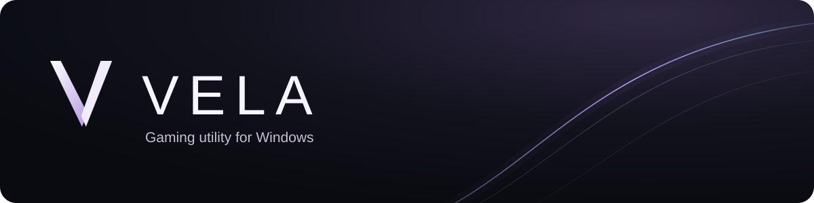
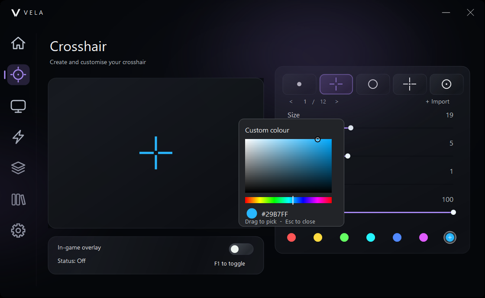
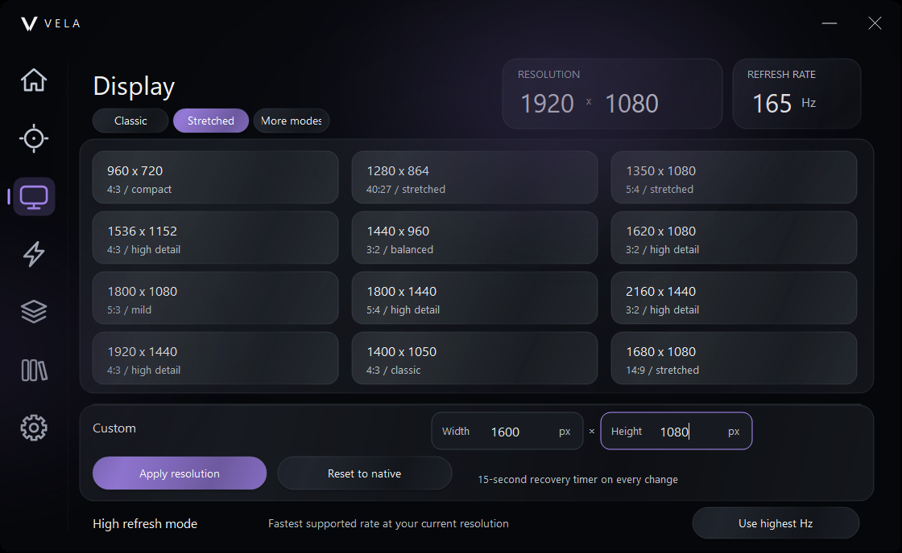

<p align="center"></p>

<p align="center"><a href="#crosshair">Crosshair</a> · <a href="#display">Display</a> · <a href="#get-the-app">Get the app</a> · <a href="LICENSE">MIT license</a></p>

**Vela** is the successor to Kova, a native Windows gaming utility. Design a crosshair, test a stretched resolution, and save the setup you want to use again.

## Crosshair

Choose a built-in shape or import a transparent PNG. Adjust its size, thickness, gap, opacity, and colour against a live preview. Press **F1** to toggle the click-through overlay in game.



## Display

Choose a competitive preset or enter a custom width and height. Vela previews the change for **15 seconds**. Click **Keep** if it looks right, or let the previous mode return automatically. Available modes and full-screen stretching depend on your monitor and GPU driver.



## Inside Vela

| Section | What you can do |
| --- | --- |
| Visibility | Drag the comparison slider to see your original and adjusted colours side by side. Bind a game to apply the adjustment when it has focus. |
| Performance | Check CPU, GPU, and memory usage. On supported NVIDIA drivers, set a game's FPS cap and power preference. |
| Game library | Launch installed Steam and Epic games, or add an executable or shortcut of your own. |
| Settings | Save named presets and choose an accent that carries through to the loading screen. |

## Get the app

The screenshots show **Vela**. Earlier releases and source files in this repository use the **Kova** name. Check the asset name on the release you download. [GitHub releases](https://github.com/fozarma/Kova/releases)

## Build on Windows

For the Kova source currently in this repository, install Visual Studio C++ Build Tools, the Windows SDK, LLVM, and Python with Pillow. Run the build script from an x64 developer command prompt.

```bat
build-windows.cmd
```

Borderless window mode is useful for overlays. Exclusive fullscreen, HDR, and driver settings can affect how display adjustments appear.

[Security policy](SECURITY.md) · [MIT license](LICENSE)
