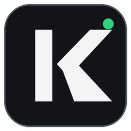

<div align="center">
  

  # Kova

  **Open-source Windows gaming utility**

  Crosshair overlays · Game-based resolution shortcuts · Desktop visibility adjustments

  [](https://github.com/fozarma/Kova/actions/workflows/build.yml)
  
  
</div>

## What Kova does

- Offers built-in crosshair styles and imports transparent PNG custom crosshairs.
- Draws an optional click-through desktop crosshair overlay (F1 to toggle).
- Suggests game-grouped stretched resolutions as well as typed custom sizes.
- Gives you a 15-second revert window after changing the display mode.
- Provides brightness, contrast, gamma and colour controls where Windows/your display driver supports them.
- Saves named preset slots **only when you explicitly choose Save**. Nothing is automatically reloaded at startup.

## Download

Download the latest `Kova.exe` from the [Releases](https://github.com/fozarma/Kova/releases) page. Only run an executable you trust. Windows SmartScreen may warn about new/unsigned software.

## Privacy & permissions

Kova works locally and does not require a sign-in. It makes Windows display-mode, overlay and colour API calls. Review [Kova.cpp](Kova.cpp) to inspect its behaviour. This repository's source availability is not a substitute for antivirus scanning, security review or third-party reproducibility checks.

**Important:** The application was cross-compiled and its PE imports were checked, but it has **not undergone comprehensive Windows runtime testing**. Use at your own risk; test display changes before relying on the app.

## Build on Windows

The included GitHub Actions workflow uses a Windows build runner and publishes its compiled `.exe` as a build artifact. This helps make the source-to-binary build process inspectable.

For a local build, install Visual Studio C++ Build Tools, LLVM with `clang-cl` and `lld-link`, Python, and Pillow, then run:

```bat
build-windows.cmd
```

The build script generates `Kova.res` from `build_icon.py`, compiles `Kova.cpp`, and links using official Windows SDK import libraries. It does not include precompiled `.lib`, `.obj`, or `.res` files.

A GitHub Actions build is **not** code signing or a guarantee that a release uploaded by the maintainer matches the workflow artifact. For best transparency, attach the workflow-produced binary to each release and publish its SHA-256 checksum.

## Compatibility notes

- Custom resolutions only work when supported by Windows and the GPU driver; whether they appear stretched or with black bars depends on GPU scaling configuration.
- Some HDR displays, GPU drivers and exclusive-fullscreen games ignore or override gamma or desktop colour processing.
- The crosshair overlay may not appear in exclusive fullscreen; borderless window mode is recommended.
- Kova is not affiliated with NVIDIA, Microsoft, Valve or any supported game developer.

## Contributing

Issues and pull requests are welcome. If you discover a security vulnerability, please read [SECURITY.md](SECURITY.md) before publicly reporting it.

## Licence

MIT — see [LICENSE](LICENSE). Ensure you only distribute image assets that you have the right to license and redistribute.
